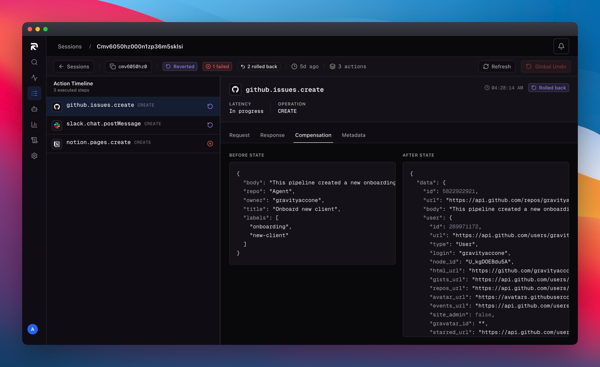

<div align="center">

  <a href="https://agentrein.com">
    
  </a>

  # AgentRein

  **AI agents can act.** They shouldn't be **irreversible.**

</div>

<p align="center">
  <a href="https://www.npmjs.com/package/agentrein"></a>
  <a href="https://pypi.org/project/agentrein/"></a>
  <a href="https://www.npmjs.com/package/@agentrein/types"></a>
  <a href="https://github.com/agentrein/agentrein/actions/workflows/ci-ts.yml"></a>
  <a href="https://github.com/agentrein/agentrein/actions/workflows/ci-python.yml"></a>
  <a href="LICENSE"></a>
</p>

<p align="center">
  <a href="https://www.typescriptlang.org/"></a>
  <a href="https://www.python.org/"></a>
  <a href="connectors/"></a>
  <a href="connectors/"></a>
  <a href="https://agentrein.com/docs"></a>
  <a href="CONTRIBUTING.md"></a>
</p>

<br>

## What is AgentRein?

AgentRein is a runtime reliability layer for AI agents that execute state-mutating operations across external APIs. By wrapping existing SDK instances with a transparent recursive proxy (`agentrein.wrap()`), AgentRein tracks side effects in real time and reverses them automatically when a multi-step workflow fails.

This monorepo (`agentrein/agentrein`) contains the open-source client SDKs (TypeScript and Python), canonical type definitions, and 9 production connectors covering 142 API action contracts.

### Core Capabilities

- **Automatic LIFO Rollback Engine:** Records mutating calls (`CREATE`, `UPDATE`, `DELETE`) in a session rollback registry, captures pre-execution state snapshots (`beforeState`), and unwinds completed actions in reverse chronological order (`Last-In, First-Out`) when an intercepted action fails or `rollbackSession()` is invoked.
- **Transparent Recursive Proxy (`wrap()`):** Intercepts deeply nested method calls on standard third-party SDKs (such as `@octokit/rest`, `stripe`, `@slack/web-api`, or `PyGithub`) without modifying call syntax or losing TypeScript type inference and IDE autocompletion.
- **Intent Verification & Drift Detection:** Evaluates execution outcomes against the session's declared `intent` (`VERIFIED`, `DRIFT_DETECTED`, `UNVERIFIED`) to catch when an agent diverges from its assigned task.
- **Organization Policy Engine:** Enforces centralized governance policies across agent runs with deterministic conflict resolution (`BLOCK > REQUIRE_APPROVAL > ALLOW`).
- **Pre- and Post-Execution Approval Gates:** Supports blocking pre-execution sign-off (`requiresApproval`) for sensitive operations and post-execution review with targeted single-action rollback if rejected.
- **Production Resilience & Transient Retries:** Configurable `failureMode` (`'open'` by default so control-plane outages never block production agents, or `'closed'` for strict workloads) alongside exponential backoff with idempotency tokens (`retryable`).
- **Zero-Side-Effect Sandbox Mode:** Test agent workflows safely without mutating external third-party services by using test API keys (`ar_test_`).

---

## Installation

```bash
# TypeScript / Node.js SDK
npm install agentrein

# Python SDK
pip install agentrein

# Canonical TypeScript Definitions (Optional, for Connector Contributors)
npm install @agentrein/types
```

---

## Quickstart

Wrap your existing SDK clients inside an AgentRein session. When wrapping, specify the matching `connector` identifier. If any intercepted step throws an unhandled exception, fails policy checks, or is explicitly rolled back, AgentRein unwinds all previously completed actions in reverse order.

### TypeScript

```typescript
import { AgentRein } from 'agentrein';
import { Octokit } from '@octokit/rest';
import { WebClient } from '@slack/web-api';

const agentrein = new AgentRein({ apiKey: process.env.AGENTREIN_API_KEY! });
const octokit = new Octokit({ auth: process.env.GITHUB_TOKEN });
const slack = new WebClient(process.env.SLACK_TOKEN);

const session = await agentrein.newSession({
  agentId: 'onboarding-agent',
  intent: 'Create a GitHub issue and notify the team on Slack',
});

// Wrap existing SDK clients with zero syntax changes — pass the connector identifier
const agentOctokit = agentrein.wrap(octokit, session, { connector: 'github' });
const agentSlack = agentrein.wrap(slack, session, { connector: 'slack' });

try {
  const issue = await agentOctokit.issues.create({
    owner: 'my-org',
    repo: 'my-repo',
    title: 'Onboarding task',
  });

  await agentSlack.chat.postMessage({
    channel: '#onboarding',
    text: `Issue created: ${issue.data.html_url}`,
  });

  await agentrein.completeSession(session);
} catch (err) {
  // Failures inside wrapped calls automatically trigger server-side LIFO rollback.
  // Explicitly call rollbackSession to ensure rollback if an error occurs in custom application code:
  await agentrein.rollbackSession(session);
  throw err;
}
```

### Python

```python
import os
from agentrein import AgentRein
from github import Github
from slack_sdk import WebClient

agentrein = AgentRein(api_key=os.environ["AGENTREIN_API_KEY"])
gh = Github(os.environ["GITHUB_TOKEN"])
repo = gh.get_repo("my-org/my-repo")
slack = WebClient(token=os.environ["SLACK_TOKEN"])

session = agentrein.new_session(
    agent_id="onboarding-agent",
    intent="Create a GitHub issue and notify the team on Slack",
)

# Wrap the specific resource or client instance — connector is a required keyword argument
agent_repo = agentrein.wrap(repo, session, connector="github")
agent_slack = agentrein.wrap(slack, session, connector="slack")

try:
    issue = agent_repo.create_issue(title="Onboarding task")

    agent_slack.chat_postMessage(
        channel="#onboarding",
        text=f"Issue created: {issue.html_url}",
    )

    agentrein.complete_session(session)
except Exception:
    agentrein.rollback_session(session)
    raise
```

> [!NOTE]
> **Python Resource Wrapping:** In Python, wrap the specific resource instance whose methods you are calling directly (e.g. wrapping `repo = gh.get_repo(...)` instead of the top-level `gh` client). This ensures method paths correctly map to the underlying connector action contracts.

### Policy Controls, Retries & Approval Gates

Configure per-client safety policies directly in `wrap()`:

```typescript
const agentStripe = agentrein.wrap(stripeClient, session, {
  connector: 'stripe',
  requiresApproval: ['customers.delete', 'refunds.create'],
  retryable: ['customers.create', 'invoices.create'],
  pollIntervalMs: 2000,
  timeoutMs: 300000,
});
```

---

## Sandbox Mode (Zero Side Effects)

To test your agents without mutating live external accounts, use a **Sandbox API Key** prefixed with `ar_test_` (generated from **Dashboard → Settings → API Keys**).

```env
# Development & Testing (Actions are simulated, no changes written to external APIs)
AGENTREIN_API_KEY=ar_test_your_sandbox_key

# Production
AGENTREIN_API_KEY=ar_live_your_production_key
```

When running in sandbox mode, AgentRein intercepts calls, logs the actions and timeline for full visibility, and synthesizes realistic responses without touching external vendor APIs.

---

## Session Timeline & Visibility

Every wrapped action, pre-execution snapshot, intent verification status (`VERIFIED` / `DRIFT_DETECTED`), policy evaluation, and LIFO compensation step is recorded in a unified session timeline.

<p align="center">
  
</p>

---

## Connectors

The [`connectors/`](connectors/) directory provides **9 connectors covering 142 mapped API actions**.

Connectors implement a standardized four-group classification system:
- **Group 1 (Create):** Reversible via inverse deletion or closure.
- **Group 2 (Update / Delete):** Reversible via state snapshot restoration (`beforeState`).
- **Group 3 (Toggle):** Reversible via inverse toggle operation (e.g., lock/unlock, archive/restore).
- **Group 4 (High-Risk / Non-Reversible):** Destructive operations (`type: 'NONE'`) gated by approval policies.

| Connector | Mapped Actions | Reversible vs Gated | Implementation | Primary Resources & Strategy |
| :--- | :---: | :---: | :--- | :--- |
| **Salesforce** | 28 | 20 rev / 8 gated | [`salesforce.connector.ts`](connectors/connectors/salesforce.connector.ts) | Accounts, Contacts, Leads, Opportunities, Cases, Tasks, SObjects — `beforeState` snapshot restoration and record deletion |
| **Slack** | 24 | 23 rev / 1 gated | [`slack.connector.ts`](connectors/connectors/slack.connector.ts) | Channels, Messages, Topics, Purposes, User Groups, Reactions, Files — message deletion, channel property restoration, and member removal |
| **GitHub** | 20 | 16 rev / 4 gated | [`github.connector.ts`](connectors/connectors/github.connector.ts) | Issues, Pull Requests, Comments, Reviews, Releases, Files, Workflows — issue/PR closure, comment deletion, and release cleanup |
| **HubSpot** | 17 | 12 rev / 5 gated | [`hubspot.connector.ts`](connectors/connectors/hubspot.connector.ts) | Contacts, Deals, Companies, Tickets, Engagements, Associations — CRM property snapshot restoration and association teardown |
| **Gmail** | 16 | 13 rev / 3 gated | [`gmail.connector.ts`](connectors/connectors/gmail.connector.ts) | Messages, Drafts, Labels, Threads — draft deletion, label restoration, and thread compensation |
| **Google Drive** | 10 | 8 rev / 2 gated | [`gdrive.connector.ts`](connectors/connectors/gdrive.connector.ts) | Files, Folders, Shared Drives, Permissions — permission revocation, folder un-trashing, and lifecycle rollback |
| **Stripe** | 10 | 5 rev / 5 gated | [`stripe.connector.ts`](connectors/connectors/stripe.connector.ts) | Invoices, Customers, Refunds, Charges, Coupons, Payment Methods — draft invoice voiding, charge refunds, and gated customer mutations |
| **Notion** | 9 | 9 rev / 0 gated | [`notion.connector.ts`](connectors/connectors/notion.connector.ts) | Pages, Database Items, Blocks — page/block un-archival and property snapshot restoration |
| **Google Sheets** | 8 | 3 rev / 5 gated | [`gsheets.connector.ts`](connectors/connectors/gsheets.connector.ts) | Spreadsheets, Sheets, Rows, Cell Value Ranges — cell range snapshot restoration and inserted row clearing |

Connectors are open for community contributions. Changes to [`connectors/`](connectors/) are type-checked in CI against [`@agentrein/types`](types/) and synchronized to the platform registry via automated workflows.

---

## Packages

| Package | Language | Registry | Directory | Description |
| :--- | :--- | :--- | :--- | :--- |
| `agentrein` | TypeScript | [npm](https://www.npmjs.com/package/agentrein) | [`sdk-ts/`](sdk-ts/) | AgentRein TypeScript SDK with recursive proxy, automatic LIFO rollback, and policy gates |
| `agentrein` | Python | [PyPI](https://pypi.org/project/agentrein/) | [`sdk-python/`](sdk-python/) | AgentRein Python SDK for AI agent execution tracking, intent verification, and undo |
| `@agentrein/types` | TypeScript | [npm](https://www.npmjs.com/package/@agentrein/types) | [`types/`](types/) | Canonical type definitions for connectors, safety levels, and rollback contracts |

---

## Monorepo Development

To build, typecheck, and test packages locally within this monorepo:

```bash
# 1. Install root workspace dependencies
npm install

# 2. Build TypeScript packages
npm run build --workspace types
npm run build --workspace agentrein

# 3. Typecheck all packages & connectors
npx tsc --noEmit --project connectors/tsconfig.json

# 4. Run Python SDK tests
pip install -e "sdk-python[dev]"
pytest sdk-python/tests
```

---

## Contributing

We welcome community contributions, especially new connectors and connector actions. Please see our [Contributing Guide](CONTRIBUTING.md) for connector contract specifications, testing instructions, and pull request checklists.

---

> [!NOTE]
> **Architecture & Repository Scope:** The AgentRein backend server, policy evaluation engine, and web dashboard are proprietary components and are not part of this repository. This repository houses the open-source client SDKs, canonical types, and connector definitions. Full platform documentation is available at [agentrein.com/docs](https://agentrein.com/docs).

---

## License

This project is licensed under the MIT License — see the [LICENSE](LICENSE) file for details.